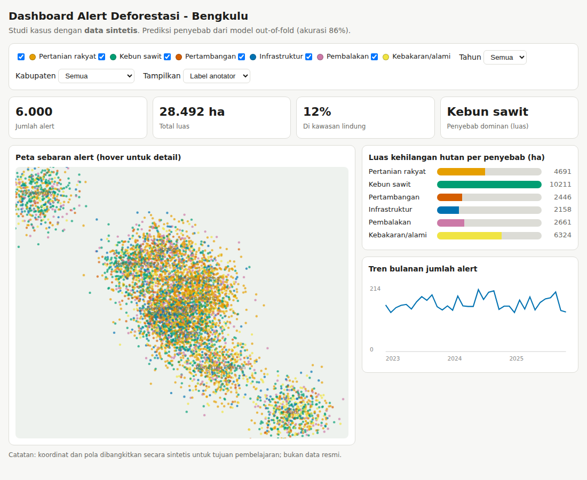

# Human-Computer Interaction & Data Visualization
Studi kasus sesi **Human-Computer Interaction & Data Visualization** - *Informatics Practitioner Lecture Series, Informatika Unib*.

**Tema:** deteksi dan atribusi penyebab deforestasi di Provinsi Bengkulu. Data **sintetis** (untuk pembelajaran).

**Tujuan:** Merancang dashboard interaktif dengan prinsip HCI dan visualisasi data yang efektif.

## Hasil singkat
- Dashboard HTML mandiri (tanpa instalasi): filter tahun/kabupaten/penyebab, KPI, peta interaktif, bar chart, tren
- Bisa membandingkan **label anotator** vs **prediksi model**



## Struktur
```
src/build_dashboard.py   # membuat HTML dashboard
data/alerts_with_predictions.csv   # hasil dari repo 04
reports/dashboard.html  # buka di browser
```

## Menjalankan
```bash
pip install -r requirements.txt
python -m src.build_dashboard
# lalu buka reports/dashboard.html di browser
```

> Catatan: `data/alerts_with_predictions.csv` dan `reports/metrics.json` adalah keluaran dari repo `04-machine-learning-intro`, disertakan agar repo ini berdiri sendiri.

## Laporan
Lihat [`docs/studi_kasus.md`](docs/studi_kasus.md).

## Repo lain dalam rangkaian studi kasus ini
- `01-data-analysis-and-ai`
- `02-hpc-parallel-processing`
- `03-gis-spatial-analysis`
- `04-machine-learning-intro`
- `06-deforestation-drivers-satellite-ai`
